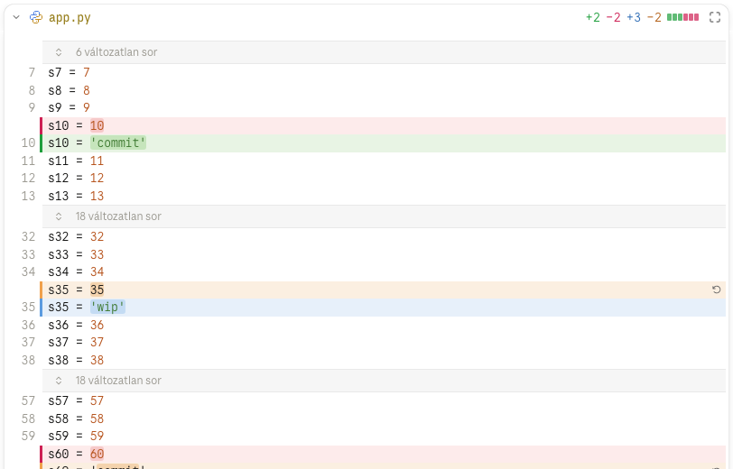

# Kóddiff és szerkesztés

Minden kóddiffet a CodeMirror rajzol, a commit-panelben és a teljes képernyőn is. Az Uncommitted sor és a
saját worktree HEAD-commitjának fájljai szerkeszthetők; a mentés automatikus. A HEAD-commit kóddiffje a
lemezen lévő szöveget mutatja, a nem commitolt eltérések kék / narancs rétegben.

## Működés



**A nézet.** A vendorolt CodeMirror 6 (`page/vendor/codemirror.min.js`) a `@codemirror/merge`-dzsel; a lap
az első kóddiffnél kéri (`page_code` `part: "codemirror"`), és blobból futtatja. Egymás alatt a régi sorok
nem szerkeszthető blokkként az új sorok fölött; 1000 px-től egymás mellett, balra a régi, jobbra az új
oldal. A megváltozott részek erősebb háttért kapnak. A szintaxist a Lezer színezi (py, js / ts / jsx / tsx,
json, css, html, md, sh, yaml, toml), a swiftet a `legacy-modes` módja, a Claude kódszíneivel; a többi
nyelv sima szöveg. Minden JSON a JSON-elemzővel megy.

**Méret.** A két oldal teljes szövege a fejadattal egy hívásban jön, ha együtt átfér a host-hídon (különben
oldalanként); a host visszafogását (`rate_limited`) a lap kivárja és újrapróbálja. Oldalanként 2 MB-ig a
teljes fájl látszik és szerkeszthető; fölötte a csonkolt hunkok, „a diff túl hosszú” felirattal, csak
olvashatóan. A sorvég a lapon mindig `\n` (a szerver normalizálja); a mentés a fájl CRLF-jét visszaállítja.

**Változatlan rés.** A legalább 4 soros változatlan rész csukva („N változatlan sor”), a fájl elején és
végén is; egy kattintásra egyben nyílik. Frissítéskor (élő adat, commitváltás) ami látszott, nyitva marad.

**Szerkesztés.** Csak olvasható a dupla kattintásig; a nem szerkeszthető nézet kurzora a nyíl. Dupla
kattintásra a kurzor oda áll, a nézet egy pixelt sem mozdul; régi soron a hozzá tartozó új sor elejére.
Szerkeszthető az Uncommitted sor szöveges fájlja (a markdown a nyers nézetben), és a saját worktree
HEAD-commitjának fájlja (a mentés az Uncommitted sorba ír). Nem szerkeszthető a Stage-elt sor, a
renderelt markdown, a kép és a 2 MB fölötti fájl. `Esc` vagy a nézeten kívüli kattintás befejezi a
szerkesztést (a teljes képernyő commitlistája kivétel); `⌘F` a CodeMirror keresőjét nyitja.

**WIP-réteg.** A saját worktree HEAD-commitjának (és a régebbi commitnak, ha a fájl azóta nem változott)
kóddiffje a lemez szövegét mutatja, régi oldala a szülő: a zöld / piros a commit változása, a kék /
narancs a WIP-é (HEAD → lemez, a stage-elt és a nem stage-elt együtt); átfedésnél a WIP színe nyer. A kék
sor a hozzáadott, a narancs blokk a HEAD-beli változata; mindkettő szókiemelést és sávjelet kap. Egymás
mellett a WIP által törölt, a szülőben is meglévő sor a bal oldalon narancs. Gépelés közben a merge régi
oldala a gépeléssel együtt változik, így a gépelt sor kék, piros / zöld nincs rajta. A narancs és a piros
blokk a kijelölés fölött áll: a blokkra eső kijelölés nem látszik, a blokk alatti sor a saját magasságában
jelölt. A fejlécen a commit `+/−` számai mellett a WIP kék / narancs számai. A renderelt markdownban nincs
WIP-réteg. Kijelölt commit nélkül ([Fájlfa és teljes nézet](full-view.md)) a commit változása nem
színeződik, csak a WIP rétege.

**Mentés.** Automatikus: 1 s csend után, `⌘S`-re azonnal, a `write_file` toolon át, az ismert
lemezállapot hashével. A lemez közbeni változását (élő frissítés) a lap befésüli, a változott sorok kéken
felvillannak, a nem mentett szerkesztés marad. Ha a lemez ugyanott változott, ahol nem mentett módosítás
van, a lap mindkét változatot mutatja („Az enyém marad” / „A lemezen lévőt veszem”), és amíg nincs
választás, nem ír. Ha a lemez szövege megegyezik a nem mentett szöveggel, az nem ütközés.

**Elvetés.** A WIP soron a hunk elvethető (a régi változatra; `⌘Z` visszahozza); a HEAD-commitban csak a
kék / narancs blokk, a zöld / piros (commit) blokk nem.

**Az író tool.** A `write_file` csak egy ismert worktree munkakönyvtárába ír: a `.git/`, a `..`, az
abszolút út és a kifelé mutató symlink tilos, bináris és nem UTF-8 fájl nem íródik. Atomi cserével ír (a
fájl jogosultsága marad), a git állapotához nem nyúl. Ha a lemezen lévő hash nem a lap által ismert, nem
ír, hanem a lemez szövegét adja vissza.

## Követelmények

```gherkin
Jellemző: Kóddiff és szerkesztés

  Szabály: R-1 — Minden kóddiffet a CodeMirror rajzol, egymás alatt vagy 1000 px-től egymás mellett

    Forgatókönyv: Egymás alatti nézet
      Adott egy commit, amely módosítja a "git_graph/diff.py" fájlt
      Ha a Fejlesztő kinyitja a fájl diffjét egy 800 px széles panelben
      Akkor a régi sorok nem szerkeszthető blokkként állnak az új sorok fölött
        És a szintaxis a Claude kódszíneivel színezett

    Forgatókönyv: Egymás melletti nézet
      Adott a diff 1200 px széles
      Akkor balra a régi, jobbra az új oldal áll, két szerkesztőben

    Forgatókönyv vázlat: Színezett nyelvek
      Adott egy "<fájl>" diffje
      Akkor a szintaxis <színezés>
      Példák:
        | fájl        | színezés                 |
        | app.py      | Lezerrel színezett       |
        | page.tsx    | Lezerrel színezett       |
        | config.toml | Lezerrel színezett       |
        | View.swift  | a swift móddal színezett |
        | main.go     | sima szöveg              |

    Forgatókönyv: 2 MB fölött
      Adott egy 3 MB-os "dump.sql" módosítása
      Akkor a diff csonkolva látszik, "a diff túl hosszú" felirattal, és nem szerkeszthető

  Szabály: R-2 — A legalább 4 soros változatlan rés csukva, egy kattintásra egyben nyílik

    Forgatókönyv: Rés a hunkok között
      Adott két hunk között 42 változatlan sor
      Ha a Fejlesztő a "42 változatlan sor" sorra kattint
      Akkor mind a 42 sor kinyílik

    Forgatókönyv: Rövid rés
      Adott két változás között 3 változatlan sor
      Akkor a rés nem csukódik össze

    Forgatókönyv: A fájl eleje és vége
      Adott az első hunk a 30. sornál kezdődik, az utolsó után 15 sor van
      Akkor a fájl elején és végén is kinyitható rés áll

  Szabály: R-3 — Az Uncommitted sor és a saját worktree HEAD-commitjának fájljai dupla kattintással szerkeszthetők, a nézet ugrása nélkül

    Forgatókönyv: Szerkesztés kezdete
      Adott az Uncommitted sorban a "git_graph/diff.py" diffje lenyitva
      Ha a Fejlesztő duplán kattint a 40. sor 12. karakterére
      Akkor a kurzor a 40. sor 12. karakterénél áll, és a nézet egy pixelt sem mozdul

    Forgatókönyv: Szerkesztés a HEAD-commitból
      Adott tiszta worktree, a HEAD-commit "app.py"-ja lenyitva
      Ha a Fejlesztő duplán kattint, gépel és ment
      Akkor a fájl a lemezre íródik, és megjelenik a WIP sor
        És a nézet a commiton marad, a szerkesztés folytatható

    Forgatókönyv vázlat: Nem szerkeszthető
      Adott <sor> "<fájl>" diffje
      Ha a Fejlesztő duplán kattint a tartalmán
      Akkor a fájl nem válik szerkeszthetővé, a kurzor a nyíl
      Példák:
        | sor                                  | fájl            |
        | a Stage-elt sor                      | app.py          |
        | egy commit sor                       | app.py          |
        | az Uncommitted sor, renderelt nézet  | README.md       |
        | az Uncommitted sor                   | logo.png        |
        | az Uncommitted sor                   | dump.sql (3 MB) |

    Forgatókönyv: Kilépés
      Adott a szerkesztés
      Ha a Fejlesztő megnyomja az Esc-et, vagy a nézeten kívülre kattint
      Akkor a szerkesztés véget ér, és a függő mentés lefut

  Szabály: R-4 — A saját worktree HEAD-commitjának kóddiffje a lemez szövegét mutatja, a WIP eltérései kék / narancs rétegben

    Forgatókönyv: WIP-eltérés a HEAD-commitban
      Adott a HEAD-commit módosítja az "app.py" 12. sorát
        És a lemezen a 14. sor is módosult, és egy új 16. sor került bele
      Akkor a 12. sor zöld, a régi változata piros blokk
        És a 14. és a 16. sor kék, a 14. sor HEAD-beli változata narancs blokk

    Forgatókönyv: Gépelés közben
      Adott a HEAD-commit "app.py"-ja szerkesztés alatt
      Ha a Fejlesztő egy változatlan sorba beír egy szót
      Akkor a sor gépelés közben is kék, piros / zöld nincs rajta

    Forgatókönyv: Ahol nincs WIP-réteg
      Adott egy régebbi commit "app.py"-ja, amelyet egy későbbi commit módosított
      Akkor csak a commit változása színes, és nem szerkeszthető

    Forgatókönyv: WIP-blokk elvetése
      Adott a HEAD-commit "app.py"-jában egy kék / narancs blokk
      Ha a Fejlesztő a blokk elvetés gombjára kattint
      Akkor a blokk a HEAD-beli változatra áll vissza, és a mentés a lemezre írja
        És a zöld / piros blokkon nincs elvetés gomb

    Forgatókönyv: Számok a fejlécen
      Adott a HEAD-commit +1 −1 sort változtatott, a lemezen még +2 −1
      Akkor a fejlécen a +1 −1 mellett kékkel +2, narancssal −1 áll

    Forgatókönyv: Kijelölés a blokkon át
      Adott egy narancs blokk (akár egy üres régi sorral) két sor között
      Ha a Fejlesztő a fölötte lévő sortól az alatta lévőig kijelöl
      Akkor a blokkra eső kijelölés nem látszik, az alatta lévő sor a saját magasságában jelölt

  Szabály: R-5 — A mentés automatikus, és a lemez változását befésüli

    Forgatókönyv: Automatikus és azonnali mentés
      Adott a szerkesztés
      Ha a Fejlesztő gépel, majd 1 s-ig nem, vagy megnyomja a ⌘S-t
      Akkor a fájl a lemezre íródik

    Forgatókönyv: Külső változás
      Adott a Fejlesztő a 40. sorban gépel
      Ha egy Claude-session a 200. sort módosítja a lemezen
      Akkor a 200. sor a nézetben frissül és kéken felvillan, a Fejlesztő szerkesztése megmarad

    Forgatókönyv: Ütközés
      Adott a Fejlesztő a 40. sort átírta, még nem mentve
      Ha egy Claude-session ugyanezt a sort másképp módosítja a lemezen
      Akkor a lap mindkét változatot mutatja, "Az enyém marad" és "A lemezen lévőt veszem" gombbal
        És amíg a Fejlesztő nem választ, nem íródik semmi

    Forgatókönyv: Azonos szöveg
      Ha a lemezre a nem mentett szöveggel azonos tartalom kerül
      Akkor az nem ütközés

  Szabály: R-6 — Az író tool csak ismert worktree munkakönyvtárába ír, atomi cserével

    Forgatókönyv vázlat: Tiltott út
      Adott az író tool hívása a "<út>" úttal
      Akkor a tool nem ír, és hibát ad
      Példák:
        | út                         |
        | .git/config                |
        | ../masik-repo/app.py       |
        | link-a-repon-kivulre/x.txt |
        | /etc/hosts                 |

    Forgatókönyv: Sorvég és záró újsor
      Adott egy CRLF sorvégű, záró újsor nélküli "win.txt"
      Ha a lap egy sort átír és ment
      Akkor a fájl CRLF sorvégű marad, záró újsor nélkül

    Forgatókönyv: Elbukott írás
      Ha az írás közben hiba történik
      Akkor a fájl ép marad, a régi tartalommal
```

## Használat

- **Szerkesztés**: dupla kattintás a kódnézetben (az Uncommitted sor vagy a saját worktree
  HEAD-commitjának fájlja). Mentés magától, 1 s után, vagy `⌘S`; befejezés: `Esc` vagy kattintás máshová.
- **Elvetés**: a blokk jobb szélén az elvetés ikonja; `⌘Z` visszahozza.
- **Rés**: a „N változatlan sor” sorra kattintva nyílik.
- **Ütközés**: a lap tetején a két gomb dönt.
