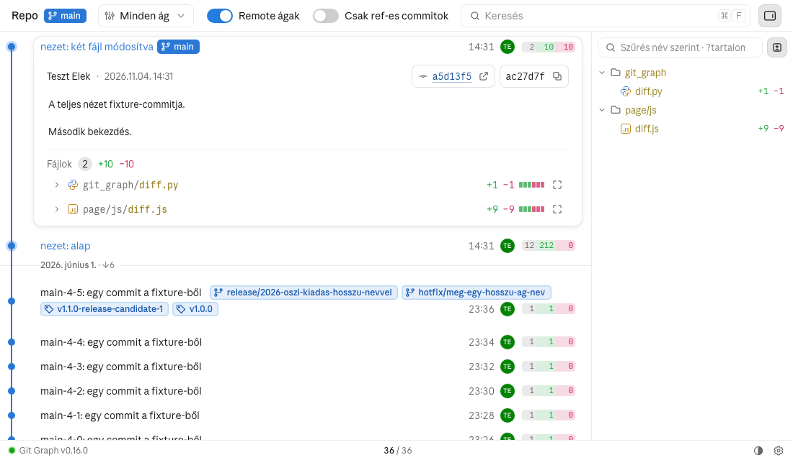
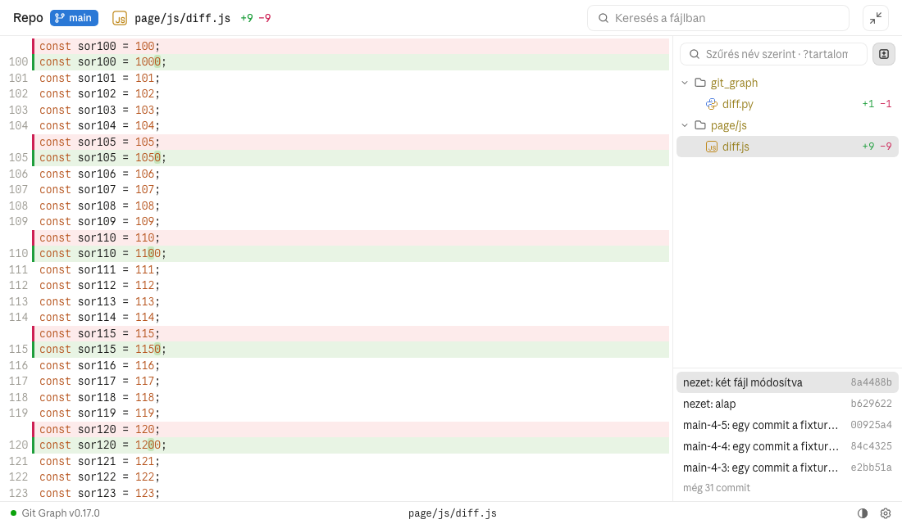

# Fájlfa és teljes nézet

A commit (vagy a munkakönyvtár) fájljai fában, a gráf mellett, és egy fájl teljes képernyőn: középen a
diffje, jobbra a fa és a commitlista. A diff maga a [Kóddiff és szerkesztés](code-diff.md) oldalon.

## Működés



**Sidebar.** Az eszközsor jobb szélső gombja a gráf mellé nyitja a fájlfát; a gráf annyival
keskenyebb, az eszközsor a megszokott. A fa a lenyitott commitot követi: a változott fájljait mutatja,
a változás színével és `+N −N` számokkal. Commit nélkül a worktree minden fájlját, színezés és számok
nélkül; ilyenkor a diff-szűrő a WIP sort nyitja le, tiszta worktree-ben a HEAD-commitot. A lenyitott commit változott fájlja a
commit-panelben nyílik le (a lap odagörget), a többi fájl teljes képernyőn. A lap megjegyzi, hogy a
sidebar nyitva van.



**Teljes képernyő.** A fájlfejléc jobb szélső ikonja nyitja (a GitHub-ikon a fájlnév után áll). A lap
tetejétől a láblécig tölti ki:

- **Fejléc** (44 px, mint az app fejléce és a lap fejléce): a repó neve és a HEAD-chip ugyanott, mint a
  lap fejlécében, utána a fájl ikonja, útja, a `+/−` és a WIP kék / narancs számai; jobbra a fájlban
  kereső és a kilépés gomb. Ha az út nem fér ki, a HEAD-chip eltűnik.
- **Középen** a diff keret nélkül, a fejléctől a láblécig, saját görgetősávval; az első változásnál nyílik.
- **Jobbra** a fa: fölötte a kereső és a diff-szűrő, alatta a commitlista. A fa szélessége 280 px-ről
  indul, legalább 200 px, húzható, és a lap megjegyzi.
- **Lábléc** (28 px) mindig látszik; a commitszám helyén a fájl útja.

**A fa.** A diff-szűrő alapból lenyomva: csak a változott fájlok, a mappáikkal; az egyetlen gyereket
tartalmazó mappalánc egy sor (`page/js`). Kikapcsolva a commit állapotának minden fájlja: a módosult
fájlok mappája a változás színét kapja (vegyes változásnál a „módosult” színt), a törölt fájl áthúzva a
helyén marad. A nem módosult fájl tartalma színezve, diffjel nélkül látszik. A fa commitonként egyben
töltődik (`file_tree`, `git ls-tree`), 20 000 fájl fölött mappánként. Ha nem jön meg, a fában pirosan a
hiba áll.

**Kereső.** Név szerint szűr; `?` előtaggal a tartalomban keres (`git grep` a kijelölt commiton, WIP
soron a munkakönyvtáron), bekapcsolt diff-szűrővel csak a változott fájlok közül. Ha a keresés elbukik,
a fában a hiba áll, nem az előző találatok.

**Commitlista.** A fa alatt: felül mindig a saját worktree WIP sora, alatta a commit ágának (a HEAD-é,
ha abban van) commitjai közül a commit és két-két szomszédja, fölöttük és alattuk a többi száma; a súgó a
teljes commit message. Másik commitra kattintva a nézet arra vált:

- a megnyitott fájl marad (ha abban a commitban nincs meg, ezt írja ki); megnyitott fájl nélkül a commit
  első változott fájlja nyílik;
- a megnyitott kódnézet nem töltődik újra, helyben frissül: a nem mentett szöveg, a szerkesztő mód és ami
  látszott (a kinyitott rések) marad. Nem szerkeszthető commitra váltva a szerkesztés véget ér, a szöveg
  előbb a lemezre íródik.

A kijelölt commitra újra kattintva (WIP sor nélkül) a kijelölés lekerül: a fa és a diff a worktree
állapota, színezés nélkül (kijelölt commit nélküli nézet). Ilyenkor a szerkesztés első mentése után
megjelenő WIP sor magától kijelölődik, a nézet helyben vált rá. Ha a kijelölt WIP sor eltűnik (a
munkakönyvtár újra tiszta), a nézet helyben a worktree állapotára vált.

## Követelmények

```gherkin
Jellemző: Fájlfa és teljes nézet

  Szabály: R-1 — A sidebar a gráf mellett a lenyitott commit fájljait mutatja

    Forgatókönyv: Sidebar nyitása
      Adott egy commit sincs lenyitva, a worktree tiszta
      Ha a Fejlesztő az eszközsor sidebar-gombjára kattint
      Akkor a gráf mellett jobbra a fájlfa nyílik, a gráf annyival keskenyebb
        És a fában a worktree minden fájlja látszik, színezés és számok nélkül

    Forgatókönyv: Diff-szűrő commit nélkül
      Adott a sidebar lenyitott commit nélkül, a worktree tiszta
      Ha a Fejlesztő a fa diff-szűrőjére kattint
      Akkor a HEAD-commit lenyílik, a fa a változott fájljait mutatja

    Forgatókönyv: Diff-szűrő commit nélkül, WIP sorral
      Adott a sidebar lenyitott commit nélkül, a worktree-ben nem commitolt változás van
      Ha a Fejlesztő a fa diff-szűrőjére kattint
      Akkor a WIP sor lenyílik, a fa a nem commitolt fájlokat mutatja

    Forgatókönyv: A WIP sor megjelenik commit nélkül
      Adott a sidebar lenyitott commit nélkül, tiszta worktree-ben, a "README.md" kijelölve
      Ha a worktree-ben új fájl jelenik meg
      Akkor a fa a WIP sor állapotát mutatja, az új fájllal
        És a "README.md" kijelölve marad, a teljes képernyő fájában is

    Forgatókönyv: A sidebar a lenyitott commitot követi
      Adott a sidebar nyitva
      Ha a Fejlesztő lenyit egy commitot, amely a "page/js/diff.js" és a "git_graph/diff.py" fájlt módosítja
      Akkor a fában csak ez a két fájl látszik, a változás színével
        És becsukva a commitot a fa újra a worktree állapotát mutatja

    Forgatókönyv: Fájl a sidebarból
      Adott a sidebar egy lenyitott commit mellett
      Ha a Fejlesztő a fában a commit egy változott fájljára kattint
      Akkor a fájl a commit-panelben lenyílik, a lap odagörget
      Ha a Fejlesztő egy nem változott fájlra kattint
      Akkor a fájl teljes képernyőn nyílik

    Forgatókönyv: A sidebar megmarad
      Adott a sidebar nyitva
      Ha a Fejlesztő újratölti a lapot
      Akkor a sidebar nyitva van

  Szabály: R-2 — A teljes képernyő a fájlfejléc ikonjával nyílik, a lap tetejétől a láblécig

    Forgatókönyv: Nyitás a fájlfejlécről
      Adott egy lenyitott commit, benne a "page/js/diff.js"
      Ha a Fejlesztő a fájl fejlécének jobb szélén a teljes képernyő ikonjára kattint
      Akkor középen a fájl diffje az első változásnál, keret nélkül, jobbra a fájlfa, benne a fájl kijelölve
        És a fejlécben a repó neve, a HEAD-chip, a fájl ikonja, útja és +/− számai, jobbra a kereső és a kilépés gomb
        És a repó neve és a HEAD-chip ugyanott áll, mint a lap fejlécében; a két fejléc 44 px magas
        És a lábléc 28 px magas, a commitszám helyén a "page/js/diff.js" út áll

    Forgatókönyv: Szűk fejléc
      Adott egy hosszú út, amely a fejlécben nem fér ki
      Akkor a HEAD-chip eltűnik, az út kapja a helyet

    Forgatókönyv: Keresés a nyitott fájlban
      Ha a Fejlesztő a fejléc keresőjébe beírja: "sor150"
      Akkor a találat kijelölve, a körülötte csukott rés kinyílik
        És Enterre a következő, Shift+Enterre az előző találatra lép, Esc törli a keresést

    Forgatókönyv: Visszalépés
      Adott a teljes képernyő, benne a "git_graph/diff.py"
      Ha a Fejlesztő megnyomja az Esc-et
      Akkor a teljes képernyő bezárul, a commit-panelben a fájl lenyitva, a lap odagörget

  Szabály: R-3 — A fa diff-szűrője a változott fájlokra szűkít, kikapcsolva minden fájlt mutat

    Forgatókönyv: Alapnézet
      Adott egy commit, amely a "page/js/diff.js" és a "git_graph/diff.py" fájlt módosítja
      Ha a teljes képernyő megnyílik
      Akkor a diff-szűrő lenyomva, a fában csak ez a két fájl látszik, a mappáikkal és +N −N számokkal
        És a "page/js" mappalánc egy sor

    Forgatókönyv: Összes fájl
      Ha a Fejlesztő a diff-szűrőre kattint
      Akkor a fában a commit állapotának minden fájlja látszik
        És a módosult fájlok mappája a változás színét kapja
        És a commit által törölt fájl áthúzva, pirosan a helyén marad

    Forgatókönyv: Változatlan fájl
      Ha a Fejlesztő egy nem módosult fájlra kattint
      Akkor a fájl teljes tartalma látszik, színezve, diffjel nélkül

    Forgatókönyv: A fájllista hibája
      Adott a fájllista nem jön meg
      Akkor a fában pirosan áll: "A fájllista nem tölthető be: …"

    Forgatókönyv: A fa szélessége
      Adott a fa még sosem volt megnyitva
      Akkor a fa 280 px széles
      Ha a Fejlesztő a fa szélét 360 px-re húzza, és újratölti a lapot
      Akkor a fa 360 px széles
        De 200 px-nél keskenyebbre nem húzható

  Szabály: R-4 — A kereső név szerint szűr, "?" előtaggal a tartalomban keres

    Forgatókönyv: Név szerinti szűrés
      Ha a Fejlesztő beírja: "register"
      Akkor a fában csak a "hooks/register.ts" és a "hooks/register.test.ts" látszik, a mappájukkal

    Forgatókönyv: Tartalomkeresés
      Ha a Fejlesztő beírja: "?DIFF_MAX_LINES"
      Akkor a fában a kijelölt commit azon fájljai látszanak, amelyekben ez szerepel
        És bekapcsolt diff-szűrővel csak a változott fájlok közül

    Forgatókönyv: Elbukott keresés
      Adott a tartalomkeresés hibát ad
      Akkor a fában a hiba áll, nem az előző keresés találatai

  Szabály: R-5 — A commitlistán commit váltható; a megnyitott fájl nézete helyben frissül

    Forgatókönyv: Commitlista a fa alatt
      Adott a commit fölött és alatt is több commit
      Akkor a fa alatt felül a WIP sor, alatta a commit és fölötte, alatta kettő-kettő, a többi száma
        És a súgó a teljes commit message

    Forgatókönyv: Commitváltás
      Adott a teljes képernyő egy megnyitott fájllal
      Ha a Fejlesztő egy olyan commitra kattint, amely ezt a fájlt nem változtatta
      Akkor a fájl marad; ha abban a commitban nincs meg, a nézet ezt írja ki

    Forgatókönyv: Helyben frissül
      Adott a fájl szerkesztés alatt, nem mentett szöveggel és kinyitott réssel
      Ha a Fejlesztő a HEAD-commit és a WIP sor közt vált
      Akkor a nézet nem töltődik újra: a szöveg, a szerkesztő mód és a kinyitott rés marad

    Forgatókönyv: Váltás nem szerkeszthető commitra
      Adott a fájl szerkesztés alatt, nem mentett szöveggel
      Ha a Fejlesztő egy régebbi commitra vált
      Akkor a szerkesztés véget ér, a szöveg előbb a lemezre íródik

  Szabály: R-6 — Kijelölt commit nélkül a fa és a diff a worktree állapota

    Forgatókönyv: A kijelölés levétele
      Adott a teljes képernyő a HEAD-commit kijelölésével, WIP sor nincs
      Ha a Fejlesztő a kijelölt commitra kattint
      Akkor a kijelölés lekerül: a fa és a diff a worktree állapota, színezés nélkül

    Forgatókönyv: Szerkesztés commit nélkül
      Adott a HEAD-commit által módosított fájl kijelölt commit nélkül
      Ha a Fejlesztő szerkeszt és ment
      Akkor a megjelenő WIP sor kijelölődik, a nézet helyben vált rá (nem töltődik újra, nem csukódik össze)

    Forgatókönyv: A WIP sor eltűnik
      Adott a WIP sor teljes képernyője
      Ha a módosítás visszaáll, és a WIP sor eltűnik
      Akkor a nézet a worktree állapotára vált: a fában és a fejlécen nincs +/−, a fájl nyitva marad
```

## Használat

- **Sidebar**: az eszközsor jobb szélső gombja. A lenyitott commit változott fájlja a panelben nyílik
  le, a többi teljes képernyőn.
- **Teljes képernyő**: a fájlfejléc jobb szélső ikonja; kilépés: `Esc` vagy a fejléc jobb szélső gombja.
- **Kereső**: a fa fölött; név szerint, `?szöveg`-gel a tartalomban. A fejléc keresője a nyitott
  fájlban keres (`Enter` / `Shift+Enter` léptet, `Esc` törli).
- **Commitváltás**: a fa alatti listán; a kijelölt commitra újra kattintva a kijelölés lekerül.
