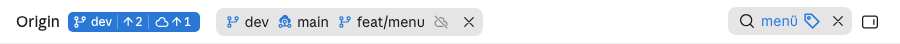
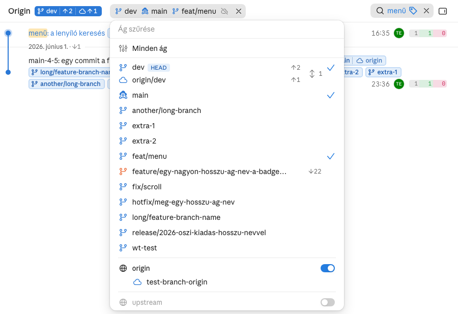
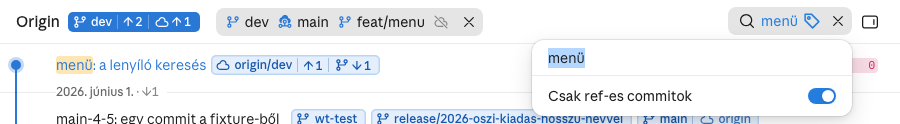

# Fejléc

A lap tetején a repó neve és a HEAD-chip mellett három gomb: az ágválasztó (a remote-ok
kapcsolóival), a keresés és a fájlok. Mindegyik az app keret nélküli ghost gombja.

## Működés



**Gombok.** Az app egérrel használt kontrolljai: 28 px magasak, 8 px-es sarokkal, háttér és keret
nélkül; az ikongomb 28 × 28, 20 px-es ikonnal. Hoverre a háttér fill-ghost-hover (5 % / 7,5 %),
nyitott lenyílóval és aktív szűrőnél fill-ghost-selected (10 % / 15 %), mint a lenyomott fájlok
gombja. A fejléc a szélesség szerint 1–3 sorba tör (`fitChrome`).

### Ágválasztó



A gomb a kijelölést mutatja (`renderSel`). Kijelölés nélkül „Minden ág”. Különben elemenként egy
ikon és név, a kijelölés sorrendjében: egy worktree összes ága (ha több van) egy elem a
worktree ikonjával; a helyi ág és az upstreamje együtt a közös ág-felhő ikonnal; a csak remote
ág a felhőjével. Legfeljebb 6 elem látszik, utána `+N`; az első legfeljebb 3 névvel, ha a gomb
500 px alatt marad és a fejléc sorában a repó és az eszközök mellett elfér (több elemnél egy név
legfeljebb 160 px). A többi csak színes ikon, a neve a súgóban; a `+N` súgója a kimaradt ágakat
sorolja, soronként egyet. Ha egy remote ki van kapcsolva, a végén halvány áthúzott felhő áll.
Kijelölésnél a gomb lenyomott hátterű, és a lenyíló nyila helyén x: „Minden ág”-ra áll vissza, a
menüt nem nyitja; a gomb többi része nyitja.

A menü tetején ikon nélküli szűrőmező (az app beágyazott keresője, 36 px), alatta a „Minden ág”,
utána az ágak (worktree-nként csoportosítva: [README](../README.md)). A végén remote-onként egy
szakaszfejléc: glóbusz, a remote neve, jobbra kapcsoló; alatta, beljebb, a csak remote ágai. A
fejléc akkor is ott van, ha a remote-nak nincs csak remote ága (különben nem lehetne
kikapcsolni). Csak a kapcsoló kattintható, a menü nyitva marad. Kikapcsolva a fejléc halvány, a
remote ágai, upstream-felhői, chipjei és a hozzá mért távolságok (`☁ ↑↓`) eltűnnek, és a csak
onnan elérhető commitok is kimaradnak; a kijelölésből is kiesnek a refjei. A „Minden ág” mindig a
látható ágak összessége: a kapcsoló a láthatóságot, a lista a kijelölést állítja.

A kapcsolók állása repónként megmarad: a lap a böngészőjében tárolja (`localStorage`, a kulcsban
a repó slugja), mint a témát.

### Keresés



Szűrő nélkül a keresés-gomb ikongomb („Keresés ⌘F” súgóval). Kattintásra vagy `⌘F`-re lenyílik:
fent ikon nélküli keresőmező (36 px, a mezőben nincs x), alatta teljes szélességű vonal után a
„Csak ref-es commitok” kapcsoló-sor. Gépelés közben szűr; a keresés az üzenetben, a törzsben, a
szerzőben, a ref-nevekben és a hash elején keres, ékezettől függetlenül, minden szónak egyeznie
kell. Egyszerre csak egy lenyíló van nyitva; kattintás kívülre bezárja a popupot, a szűrés marad.

Szűrve a gomb lenyomott hátterű, és sorban mutatja: keresés-ikon, a keresett szöveg (~160 px-nél
„…”), a ref-szűrő címke-ikonja, x. Akcentus színű csak a szöveg és a címke. Az x (24 px, 6 px-es
sarok, saját hover) mindkét szűrőt törli, a popupot nem nyitja.

Az `Esc` a keresőmezőben előbb a keresett szöveget törli (a ref-szűrő és a popup marad), üres
mezőben a popupot zárja; zárt popupnál is a szöveget törli. Ha közben nyitva volt egy commit, a
teljes listában az kerül legfelülre.

## Követelmények

```gherkin
# A fejlécben a repónév, az ágválasztó, a keresés-gomb és a fájlok gomb áll. A remote-ok az
# ágválasztóban kapcsolhatók, a ref-szűrő a keresés lenyílójában ül.
Jellemző: Fejléc: ágválasztó remote-kapcsolókkal és lenyíló keresés

  Szabály: R-1 — A fejléc gombjai keret nélküli ghost gombok
    Forgatókönyv: Nyugalmi állapot
      Adott a lap világos témában, szűrő nélkül
      Ha a lap betölt
      Akkor az ágválasztó, a keresés-gomb és a fájlok gomb háttere áttetsző, kerete nincs
        És mindhárom 28 px magas, a sarokív 8 px

    Forgatókönyv: Hover
      Adott a lap sötét témában
      Ha az egér az ágválasztó fölé áll
      Akkor a gomb háttere a fill-ghost-hover (7,5 %-os fehér), a szöveg text-primary

    Forgatókönyv: Nyitott lenyíló
      Adott a lap világos témában
      Ha a Fejlesztő megnyitja az ágválasztót
      Akkor a gomb háttere a fill-ghost-selected (10 %-os fekete), amíg a lenyíló nyitva van

  Szabály: R-2 — A keresés egy gomb, ami lenyílik a mezővel és a ref-kapcsolóval
    Forgatókönyv: Szűrő nélkül a gomb csak egy ikon
      Adott üres keresés és kikapcsolt ref-szűrő
      Ha a lap betölt
      Akkor a keresés-gomb egy 28 px-es ikongomb 20 px-es ikonnal, „Keresés ⌘F” súgóval

    Forgatókönyv: Kattintásra lenyílik
      Adott a zárt keresés-gomb
      Ha a Fejlesztő rákattint
      Akkor a popupban az ikon nélküli keresőmező kapja a fókuszt
        És alatta, teljes szélességű vonal után a „Csak ref-es commitok” kapcsoló-sor áll

    Forgatókönyv: ⌘F a mezőt nyitja
      Adott a nyitott ágválasztó
      Ha a Fejlesztő ⌘F-et nyom
      Akkor az ágválasztó bezárul, a keresés popupja megnyílik, a fókusz a keresőmezőben van

    Forgatókönyv: A ref-kapcsoló a popupban
      Adott a nyitott keresés
      Ha a Fejlesztő bekapcsolja a „Csak ref-es commitok” sort
      Akkor a lista csak a reffel jelölt commitokat mutatja, a popup nyitva marad

    Forgatókönyv: Esc a mezőben a szöveget törli
      Adott a nyitott keresés "menü" szöveggel és bekapcsolt ref-szűrővel
      Ha a Fejlesztő Esc-et nyom
      Akkor a keresés üres, a ref-szűrő bekapcsolt, a popup nyitva marad
        És újabb Esc-re a popup bezárul

    Forgatókönyv: Kattintás kívül bezár, a szűrés marad
      Adott a nyitott keresés "menü" szöveggel
      Ha a Fejlesztő a commitlistára kattint
      Akkor a popup bezárul, a szűrés megmarad

  Szabály: R-3 — A szűrt keresés-gomb kiírja a szűrést, és egy x törli
    Forgatókönyv: Szöveg és ref-szűrő
      Adott a "menü" keresés és a bekapcsolt ref-szűrő
      Ha a popup bezárul
      Akkor a gomb sorban mutatja: keresés-ikon, "menü", címke-ikon, x
        És a gomb háttere a lenyomott fájlok gombjáé
        És csak a "menü" és a címke akcentus színű

    Forgatókönyv: Hosszú keresett szöveg
      Adott a "nagyon-hosszu-keresett-kifejezes-a-commitokban" keresés
      Ha a popup bezárul
      Akkor a gombon a szöveg kb. 160 px-nél „…”-ra végződik

    Forgatókönyv: Az x mindkét szűrőt törli
      Adott a "menü" keresés és a bekapcsolt ref-szűrő, zárt popup
      Ha a Fejlesztő az x-re kattint
      Akkor a keresés üres, a ref-szűrő kikapcsolt, a lista teljes
        És a popup nem nyílik meg
        És a gomb újra csak egy ikon

  Szabály: R-4 — Az ágválasztó gombja a kijelölést mutatja
    Forgatókönyv: Nincs kijelölés
      Adott nincs kijelölt ág
      Ha a lap betölt
      Akkor a gomb felirata „Minden ág”, a végén lenyíló nyíl

    Forgatókönyv: Ág és upstreamje
      Adott a kijelölt "dev" és "origin/dev"
      Ha a lap betölt
      Akkor a gomb a közös ág-felhő ikont és a "dev" nevet mutatja

    Forgatókönyv: Öt ág
      Adott a kijelölt "dev", "main", "feat/menu", "wt-test" és "fix/scroll"
      Ha a lap betölt
      Akkor az első 3 ikonnal és névvel áll, a "wt-test" és a "fix/scroll" csak színes ikonnal

    Forgatókönyv: Keskeny fejléc
      Adott 4 hosszú nevű kijelölt ág
      Ha a fejléc 640 px széles
      Akkor kevesebb név áll, és a fejléc egy sorban marad

    Forgatókönyv: Kilenc ág
      Adott 9 kijelölt ág
      Ha az egér a „+3” fölé áll
      Akkor a gombon 6 elem látszik, utána „+3”
        És a buborék a kimaradt 3 ág nevét sorolja fel, soronként egyet

    Forgatókönyv: Egy teljes worktree egy elem
      Adott a "menu-merge" worktree összes ága és a "dev" kijelölve
      Ha a lap betölt
      Akkor a gomb két elemet mutat: a worktree ikonját a "menu-merge" névvel, és a "dev"-et

    Forgatókönyv: x a nyíl helyén
      Adott a kijelölt "dev"
      Ha a Fejlesztő a gomb x-ére kattint
      Akkor a felirat „Minden ág”, a lista teljes, a menü nem nyílik meg
        És a gomb háttere áttetsző

  Szabály: R-5 — A remote-ok az ágválasztó szakaszfejlécén kapcsolhatók, remote-onként
    Forgatókönyv: Remote-onként egy fejléc
      Adott a repó két remote-ja: "origin" és "upstream"
      Ha a Fejlesztő megnyitja az ágválasztót
      Akkor mindkét remote-nak van szakaszfejléce: glóbusz-ikon, a remote neve, bekapcsolt kapcsoló
        És a csak remote ágai a fejléc alatt beljebb kezdődnek

    Forgatókönyv: A fejléc csak remote ág nélkül is ott van
      Adott az "upstream" remote, amelynek minden ágának van helyi párja
      Ha a Fejlesztő megnyitja az ágválasztót
      Akkor az "upstream" fejléce kapcsolóval ott van, alatta nincs ág

    Forgatókönyv: Egy remote kikapcsolása
      Adott a két remote, mindkettő bekapcsolva
      Ha a Fejlesztő az "upstream" fejlécének kapcsolójára kattint
      Akkor az "upstream" fejléce halványan megmarad, a kapcsoló kikapcsolt
        És az "upstream" ágai és upstream-felhői eltűnnek a menüből és a gráfból
        És a menü nyitva marad
        És a gombon halvány áthúzott felhő áll, a gomb háttere áttetsző

    Forgatókönyv: Minden remote kikapcsolva
      Adott a két remote, mindkettő kikapcsolva, nincs kijelölt ág
      Ha a Fejlesztő megnézi a fejlécet és a menüt
      Akkor a menü első sora és a gomb felirata „Minden ág”, utána halvány áthúzott felhő
        És minden helyi ág és a teljes helyi történet látszik

    Forgatókönyv: Kijelölt remote ref elrejtése
      Adott a kijelölt "origin/test-branch-origin"
      Ha a Fejlesztő kikapcsolja az "origin"-t
      Akkor az "origin/test-branch-origin" kikerül a kijelölésből

    Forgatókönyv: Remote nélküli repó
      Adott egy remote nélküli repó
      Ha a Fejlesztő megnyitja az ágválasztót
      Akkor nincs remote-fejléc, és a gombon nincs áthúzott felhő

  Szabály: R-6 — A remote-ok állása repónként megmarad
    Forgatókönyv: Újratöltés után
      Adott a kikapcsolt "upstream"
      Ha a lap újratölt
      Akkor az "upstream" továbbra is kikapcsolt

    Forgatókönyv: Másik repó
      Adott az A repóban kikapcsolt "origin"
      Ha a B repó lapja betölt
      Akkor a B repó "origin"-je bekapcsolt
```

## Használat

- **Ág szűrése**: az ágválasztó; a sorra kattintva csak az, a pipára kattintva hozzáad vagy kivesz.
  Vissza minden ágra: a gomb x-e vagy a menü „Minden ág” sora.
- **Remote elrejtése**: az ágválasztó végén a remote fejlécének kapcsolója.
- **Keresés**: `⌘F` / `Ctrl+F` vagy a nagyító; `Esc` a szöveget törli, a gomb x-e mindkét szűrőt.
- **Csak ref-es commitok**: a keresés popupjának kapcsoló-sora.

Tesztek: `tests/page/test_header.py`.
