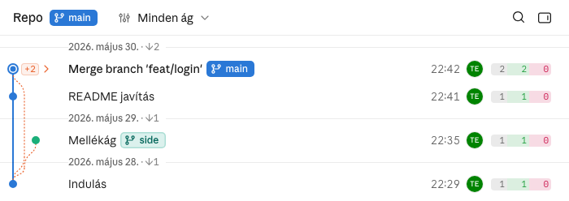
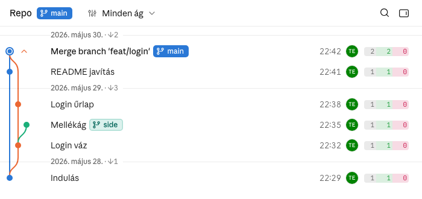

# Merge-ek összecsukása

A merge-commit a gráf fő pontja: gyűrűs pöttyel kiemelkedik, a beolvasztott commitjai alapból
alá csukódnak, és merge-enként a gráfoszlopra kattintva kibonthatók. Így a sok merge-dzsel
dolgozó repó listája a fő vonalakra szűkül, a részlet pedig egy kattintásra elérhető.

## Működés





### A merge pontja

Telt mag gyűrűvel, egy színben (a merge sávjáé), köztük háttérszínű rés; a friss merge udvara
10 px (a sima commité 8 px). A subject a sima commitéval egyező színű, picit vastagabb
(`--w-medium`). A WIP-sor, a stash és a tükör-commit pontja üres karika marad.

### Mi kerül a merge alá

A merge birtoka az, amit a 2. (vagy további) szülőjén át hozott be, vagyis a `git log M^1..M`.
A lap számolja (`page/js/merges.js`), szerverhívás nélkül: a merge-eket a régebbitől
az újabb felé járja be, így a beágyazott merge a saját ágát birtokolja, a külső a belső merge-et
és a saját ágát. A ref-es commit (lokális és remote branch, tag, HEAD, stash, WIP, worktree
HEAD-je, gyerek nélküli commit) maga mindig látszik, mert a chipjének sor kell; az alatta lévő
beolvasztott lánc viszont rejtett, és szaggatott él köti az első látható commithoz. Ugyanígy az
összecsukott merge éle: a rejtett ág sávjában, szaggatottan fut a cél fölé. A szaggatott él olyan
vastag, mint a fő vonal (2 px), és a cél fölött ívben fordul a cél sávjába, akkor is, ha a cél a
közvetlenül alatta lévő sor. Ha a merge 2.
szülője a merge alatti látható sorból ágazik, él nincs. Ha egy ág egy másik merge ágára épül, a
pontozott vége ennek a merge-nek a szárába (a 2. szülő-élébe: összecsukva pontozott, kibontva
folytonos) fut be, mindig felül, legkésőbb a szár fordulópontjánál (a cél előtt egy sornyival):
kibontva a legalsó commitja alól egy sornyi ívvel, összecsukva a merge-e a saját sávjában a másik
merge alá fut, és ott csatlakozik. Az ív annak az ágnak a színét kapja, amelyikből jön. Onnan
egyetlen vonal megy tovább, a kibontás és az összecsukás animációja alatt is. Ha a ráépülő merge-et
egy kibontott másik merge mellett csukják össze vagy nyitják ki, a csatlakozás ugyanaz a vonal marad:
a fordulója a csúcs fölötti helyről a másik merge alatti helyre csúszik (és vissza), közben
folytonosból pontozottá vált. A csupa rejtett commitból álló napnak
nincs fejléce.

### A szám és a nyíl

Összecsukva a merge pöttye mellett, a gráfoszlopban `+N` áll: a kibontáskor közvetlenül
megjelenő sorok száma (a belső merge-ek alá rejtettek és a ref-es commitok nem számítanak).
Halvány, a beolvasztott ág (2. szülő) színével tintelt kis címke vékony kerettel, 11 px-es
betűvel; a háttere a gráf vonalát is takarja. Utána, csak a merge gráfoszlopa fölött, a nyíl:
a lenyíló menü 16 px-es CaretDown-ja, ugyanabban a színben, háttér nélkül; összecsukva jobbra,
kibontva felfelé mutat, és a közepe pont a merge melletti két sáv között áll. A gráfoszlop a lap legszélesebb
számához igazodik, így a subject a nyíl után 10 px-re kezdődik.

### Kétrészes sor

A sor sávja (subject, idő, avatar, diff) kap szürke hover-kiemelést, és a commitot nyitja. A
merge gráfoszlopa (a sávig) a merge kapcsolója: kibont vagy összecsuk, a `+N`-re kattintva is;
a commit-panelt nem nyitja. A sima commit gráfoszlopa nem reagál: nincs kiemelés, nincs nyíl,
nem nyit semmit. Billentyűvel a merge nem bontható ki.

### Animáció

Kibontáskor a megjelenő sorok magassága 200 ms alatt 0-ról nő, a gráf vonala képkockánként
velük nyúlik; közben a szám összemegy (az út második felében 20 %-ig halványul), a nyíl
utánacsúszik a pötty mellé, és 90°-ot fordul jobbról felfelé; a pontozott él elhalványul, a
lenyíló sorok, és az ág élei és pöttyei beúsznak. Összecsukáskor fordítva, ugyanazzal
a görbével, mint a sorok felcsukódása: a sorok 200 ms alatt 0-ra csukódnak, és csak utána tűnnek
el; közben a szám 0 szélességről nő (20 %-os fedésről, félúton teljes), maga előtt tolva a
jobbra forduló nyilat; a három egyszerre ér véget. A felcsukódó sorok, és az ág élei és pöttyei
ugyanezzel a haladással halványulnak el, a merge pontozott éle pedig közben úszik be, így a végén a gráf nem
ugrik. A forgatás szögekkel animál (−90° ↔ −180°),
mert a mátrixok közti átmenet tükrözésnek bomlana. Az újrarajzolt nyíl nem villan: amíg az egér
a gráfoszlopon marad, a `.hover` osztály átmenet nélkül tartja látszón. A
`prefers-reduced-motion` szabály ezt is leállítja.

### Állapot és beállítás

A merge-enkénti kézi állapot csak a lap memóriájában él: az élő frissítés megtartja, az
újratöltés az alapállapotra állítja. Az alapállapot repónkénti beállítás, a fogaskerék-menü
„Merge-ek összecsukása” kapcsolója (`git-graph.collapseMerges` a `.git/config`-ban, a
`settings` tool írja; hiányzó kulcs = bekapcsolva). A váltása törli a kézi állapotokat. A
`graph_data` a `meta.collapseMerges`-ben hozza, így már az első rajzolás a repó beállítását
követi. Ha egy cél rejtett commitra mutat (keresési találat, a nyitott commit-panel, ugrás a
szülőre), a tartalmazó merge-ek kibontódnak.

## Követelmények

```gherkin
Jellemző: Merge-ek összecsukása

  Szabály: R-1 — A merge pontja egyszínű telt mag gyűrűvel, a subjectje picit vastagabb
    Forgatókönyv: Kétszülős commit a gráfban
      Adott egy repó, ahol a "Merge branch 'feat/login'" commitnak két szülője van
      Ha a User megnyitja a lapot
      Akkor a merge pontja egy 3,5 px sugarú telt mag, körülötte 6 px sugarú, 2 px vastag gyűrű
        És a mag és a gyűrű is a merge sávjának színe, köztük háttérszínű rés
        És a subject színe a sima commité, a vastagsága picit nagyobb

    Forgatókönyv: Új merge-commit udvara
      Adott egy merge-commit, amely a lap megnyitása óta érkezett
      Ha a lap kirajzolja
      Akkor a merge pontja körül 10 px sugarú udvar van, egy sima commit körül 8 px

  Szabály: R-2 — Amit a merge a 2. szülőjén át hozott be, összecsukva rejtett; a ref-es commit látszik
    Forgatókönyv: Törölt branch beolvasztott commitjai
      Adott a "main"-en "Indulás", "README javítás" és a "feat/login" merge-e, a branch törölve
      Ha a User megnyitja a lapot
      Akkor a lista sorai: "Merge branch 'feat/login'", "README javítás", "Indulás"

    Forgatókönyv: A beolvasztott ágból leágazó branch
      Adott a "Login váz"-ból leágazó, megmaradt "side" branch a "Mellékág" committal
      Ha a User megnyitja a lapot
      Akkor a "Mellékág" látszik, a "Login váz" rejtett
        És a "Mellékág"-tól az "Indulás"-ig szaggatott él fut

    Forgatókönyv: Tag a beolvasztott ágon
      Adott a "Login váz" commiton a "v0.9" tag
      Ha a User megnyitja a lapot
      Akkor a "Login váz" a chipjével látszik, a "Login űrlap" rejtett
        És a merge-től a "Login váz"-ig szaggatott, onnan folytonos él fut

    Forgatókönyv: Szaggatott él a közvetlenül alatta lévő sorba
      Adott a "Login űrlap"-on az "origin/feat/login", az "Indulás" vele egy napon
      Ha a User megnyitja a lapot
      Akkor a "Login űrlap"-tól az "Indulás"-ig futó szaggatott él a cél fölött ívben fordul
        És a szaggatott él olyan vastag, mint a fő vonal

    Forgatókönyv: Összecsukott ágra épülő kibontott ág
      Adott a login-ág csúcsára épülő, később mergelt profil-ág kibontva, a login-merge összecsukva
      Ha a lap kirajzolja a gráfot
      Akkor a "Profil oldal" pontozott vége egy sornyi ívvel a login-merge szárába fut be
        És az "Indulás"-ig egyetlen pontozott vonal ér le

    Forgatókönyv: Kibontott merge szárába
      Adott a login-merge kibontva, a profil-merge összecsukva
      Ha a lap kirajzolja a gráfot
      Akkor a profil-merge pontozott éle a login-merge alatt fut be a login-ág sávjába, nem a "Login űrlap"-nál

    Forgatókönyv: Mindkét merge összecsukva
      Adott a profil-merge és a login-merge is összecsukva
      Ha a lap kirajzolja a gráfot
      Akkor a profil-merge pontozott éle a login-merge alatt a login-merge szárába csatlakozik
        És az "Indulás"-ig egyetlen pontozott vonal ér le

    Forgatókönyv: Szomszédos kiindulópont
      Adott egy merge, amelynek 2. szülője a merge alatti látható sorból ágazik
      Ha a lap kirajzolja a gráfot
      Akkor a merge-ből nem indul él a 2. szülő felé

    Forgatókönyv: Napfejléc csak látható sor fölött
      Adott egy nap, amelynek minden commitja rejtett
      Ha a User megnyitja a lapot
      Akkor annak a napnak nincs fejléce, kibontás után visszajön

  Szabály: R-3 — Összecsukva a pötty mellett "+N" áll a beolvasztott ág színében
    Forgatókönyv: A rejtett sorok száma
      Adott egy összecsukott merge két rejtett commit fölött
      Ha a User megnyitja a lapot
      Akkor a pöttye mellett "+2" áll, halvány tint címkeként kerettel
        És a szám és a nyíl színe a beolvasztott ág sávszíne
        És a subject a nyíl után 10 px-re kezdődik

    Forgatókönyv: Belső merge saját számmal
      Adott egy összecsukott merge, amelynek ágában egy összecsukott belső merge van
      Ha a User kibontja a külső merge-et
      Akkor a belső merge összecsukva, saját számmal jelenik meg

  Szabály: R-4 — A sor sávja a commitot, a merge gráfoszlopa a merge-et nyitja
    Forgatókönyv: Hoverkor megjelenő nyíl
      Adott egy összecsukott merge-sor
      Ha a User a merge gráfoszlopa fölé viszi az egeret
      Akkor a "+2" után jobbra mutató, 16 px-es nyíl jelenik meg
        És a sor sávja fölött a nyíl nem látszik

    Forgatókönyv: Kibontás a gráfoszlopra kattintva
      Adott egy összecsukott merge-sor
      Ha a User a merge gráfoszlopára kattint (a "+2"-re is)
      Akkor a beolvasztott commitok a merge alá kerülnek, a commit-panel nem nyílik meg

    Forgatókönyv: A sima commit gráfoszlopa nem reagál
      Adott egy nem merge commit sora
      Ha a User a gráfoszlopa fölé viszi az egeret, és rákattint
      Akkor nincs kiemelés, nincs nyíl, és nem nyílik meg semmi
        És a sor sávjára kattintva a commit-panel nyílik

  Szabály: R-5 — A kibontás és az összecsukás 200 ms-os animáció, a szám és a nyíl a sorokkal mozog
    Forgatókönyv: Kibontás
      Adott egy összecsukott merge "+2" számmal
      Ha a User kibontja
      Akkor a sorok 200 ms alatt lenyílnak, a gráf velük nyúlik
        És közben a szám összemegy és halványul, a nyíl a pötty mellé csúszik, és felfelé fordul
        És közben a pontozott él elhalványul, a lenyíló ág beúszik

    Forgatókönyv: Összecsukás
      Adott egy kibontott merge
      Ha a User összecsukja
      Akkor a sorok 200 ms alatt felcsukódnak, és csak utána tűnnek el
        És közben a szám 20 %-os fedésről nő, maga előtt tolva a jobbra forduló nyilat
        És közben a felcsukódó ág halványul, a pontozott él beúszik
        És a három egyszerre ér véget, a nyíl végig látszik

  Szabály: R-6 — A kézi állapot az újratöltésig él
    Forgatókönyv: Élő frissítés
      Adott egy kézzel kibontott merge
      Ha új commit érkezik a repóba
      Akkor a merge kibontva marad

    Forgatókönyv: Újratöltés
      Adott egy kézzel kibontott merge
      Ha a User újratölti a lapot
      Akkor a merge újra összecsukva jelenik meg

  Szabály: R-7 — Rejtett commitra mutató cél kibontja a tartalmazó merge-et
    Forgatókönyv: Keresési találat
      Adott egy összecsukott merge alatt a "Login űrlap"
      Ha a User a keresőbe írja: "Login űrlap"
      Akkor a merge kibontódik, és a "Login űrlap" találatként látszik

    Forgatókönyv: Nyitott panel commitja
      Adott a "Login űrlap" commit-panelje nyitva, kibontott merge alatt
      Ha a User bekapcsolja a "Merge-ek összecsukása" beállítást
      Akkor a merge kibontva marad, a panel nyitva

  Szabály: R-8 — A "Merge-ek összecsukása" repónkénti beállítás, alapból bekapcsolva
    Forgatókönyv: Kapcsoló a fogaskerék-menüben
      Adott a lap nyitott fogaskerék-menüvel
      Ha a User kikapcsolja a "Merge-ek összecsukása" kapcsolót
      Akkor minden beolvasztott commit látszik, és a kézi állapotok törlődnek
        És a ".git/config"-ban "git-graph.collapseMerges = false" áll

    Forgatókönyv: Az első rajzolás a repó beállítását követi
      Adott egy repó "git-graph.collapseMerges = false" beállítással
      Ha a User megnyitja a lapot
      Akkor az első lista kibontott, nem villan fel összecsukva
```

## Használat

- **Kibontás, összecsukás**: kattintás a merge-sor gráfoszlopára (a pötty, a `+N` vagy a nyíl
  környéke); a sor többi része a commitot nyitja.
- **Alapállapot repónként**: a lábléc fogaskerék-menüje → „Merge-ek összecsukása”; vagy a
  `settings` tool `collapseMerges` mezője.
- **Képek**: `uv run --no-project --with playwright==1.63.0 python scripts/screenshots.py`
  (`MergeShots`, a `tests/page/test_merges.py` fixture-repójából).
