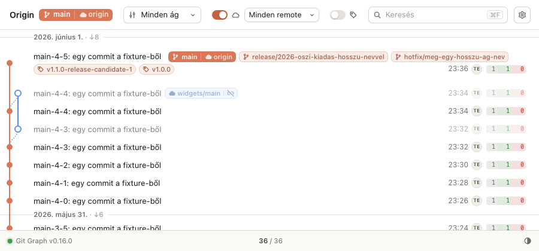
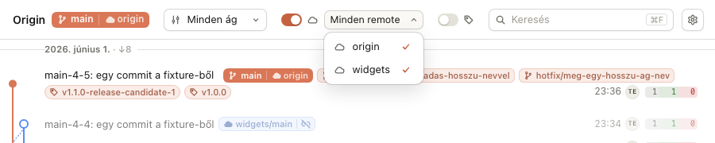

# Subtree-remote

Egy `git subtree split` / `push` remote-ja (pl. egy mappa külön repóba tükrözve) a
gráfban: a története a fő történettől független, és a commitjai a fő történet
commitjainak tükrei — ugyanaz a subject, szerző és author-dátum, más hash.

## Működés



### Független történet a chipen

Az ág chipje az alapághoz (amire az `origin/HEAD` mutat) mért távolságot mutatja
(`↑a ↓b`). Közös ős nélkül ez a két oldal összes commitja volna (pl. `↑4 ↓296`), ami
félrevezető: ilyenkor a távolság helyén, egy elválasztó után áthúzott lánc áll, a
tooltip pedig kimondja: „Külön történet: nincs közös őse az alapággal”. A helyi és a csak
remote-on élő ágra is érvényes.

A szerver (`branch_tracks`) a `for-each-ref` `%(ahead-behind:…)` számaiból dönt:
nincs közös ős ⇔ az alapág egyetlen commitja sem érhető el a refből, azaz a lemaradás
az alapág teljes commitszáma. Ehhez egyetlen `git rev-list --count <alapág>` kell, és az
is csak akkor fut, ha van ág, amelynek mindkét iránya nem nulla (a `claude-plugins`
repóban 0,01 s); refenkénti `merge-base` nincs.

### Tükör-commitok a forráshoz kötve

A subtree-remote commitjai a fő történet commitjainak másolatai. A tükör-commit sora
halvány (mint a más worktree-é), a gráfpöttye üres karika, és a pöttyétől vékony,
szaggatott ív fut a forrás-commit pöttyéhez, a tükör sávjának színével. Ha a forrás
nem látszik (szűrő), az ív elmarad.

A párosítás a szerveren történik (`mark_mirrors`), a `graph_data`-ban a tükör-commit
`mirrorOf` mezője a forrás sha-ja. Tükör az a commit, amelynek
- van párja a látható commitok közt ugyanazzal a subjecttel, szerzővel és author-dátummal,
- a kettőnek nincs közös őse (nincs közös gyökér-commitjuk),
- és a pár az alapág történetéhez tartozik, a tükör nem.

A cherry-pick ezért nem tükör: a másolatnak közös őse van az eredetivel. A gyökereket a
lap commitjaiból számolja (egy menet); ahol a limit elvágja a történetet, ott a jelöltekre
`git rev-list --max-parents=0` dönt.

### Remote szerinti szűrő



Több remote-nál a „Remote ágak” kapcsoló mellett egy lenyíló menü remote-onként ki-be
kapcsolja, mely remote-ok ágai látszanak (pl. `widgets` ki, `origin` be). A rejtett
remote ágainak chipje, ágválasztó-sora és a hozzá mért távolság (`☁ ↑↓`) eltűnik, és a
csak onnan elérhető commitok (pl. a tükör-commitok) is kimaradnak. A gomb felirata a
látható remote-ok neve, vagy „Minden remote”. Ha a kapcsoló ki van kapcsolva, a gomb
tiltott; egyetlen remote-nál nem jelenik meg.

A választás repónként megmarad: a lap a böngészőjében tárolja (`localStorage`, a kulcsban
a repó slugja), mint a témát és a diff-nézeteket.

## Követelmények

```gherkin
# Egy `git subtree split` / `push` remote-ja helyesen jelenik meg a gráfban.
Jellemző: Subtree-remote a gráfban

  Szabály: R-1 — A közös ős nélküli ág chipje nem mutat távolságot az alapághoz
    Forgatókönyv: Subtree-remote ága
      Adott a "widgets/main" remote ág, amelynek nincs közös őse az "origin/main"-nel
      Ha a Fejlesztő a chipje fölé viszi az egeret
      Akkor a chipen nincs "↑" és "↓" szakasz
        És egy elválasztó után áthúzott lánc ikon áll
        És a tooltip: "Külön történet: nincs közös őse az alapággal"

    Forgatókönyv: Szétvált, de rokon ág
      Adott a "feat" ág, amely 1 committal előrébb és 1 committal mögötte jár az "origin/main"-nek
      Ha a Fejlesztő megnézi a chipjét
      Akkor a chipen "↑1 ↓1" áll

  Szabály: R-2 — A tükör-commit halvány, és a forrásához kötve látszik
    Forgatókönyv: Subtree-remote commitja
      Adott a "widgets/main" "c678e84" commitja, a "main" "e7113d9" commitjának tükre, közös ős nélkül
      Ha a Fejlesztő megnyitja a lapot
      Akkor a "c678e84" sora halvány
        És a gráfpöttye üres karika
        És szaggatott ív köti az "e7113d9" pöttyéhez

    Forgatókönyv: Cherry-pick
      Adott a "pick" ágon a "main" egy commitjának cherry-pickje
      Ha a Fejlesztő megnyitja a lapot
      Akkor a cherry-pick sora nem halvány, és nem kap ívet

  Szabály: R-3 — A remote-ok ágai remote-onként elrejthetők
    Forgatókönyv: Egy remote elrejtése
      Adott a repó két remote-ja: "origin" és "widgets"
      Ha a Fejlesztő a remote-szűrőben kikapcsolja a "widgets"-et
      Akkor a "widgets/main" chipje és ágválasztó-sora eltűnik
        És a csak a "widgets"-ből elérhető commitok kimaradnak
        És az "origin" ágai látszanak
        És a gomb felirata "origin"

    Forgatókönyv: A választás megmarad
      Adott a rejtett "widgets" remote
      Ha a lap újratölt
      Akkor a "widgets" továbbra is rejtett

    Forgatókönyv: Egyetlen remote
      Adott a repó egyetlen remote-ja: "origin"
      Ha a Fejlesztő megnyitja a lapot
      Akkor a remote-szűrő nem jelenik meg
```

## Használat

- A chip tooltipje (hover) mondja ki, hogy az ág külön történet.
- A subtree-remote zavar? A „Remote ágak” melletti menüben kapcsold ki: az ágai és a
  tükör-commitjai eltűnnek.
